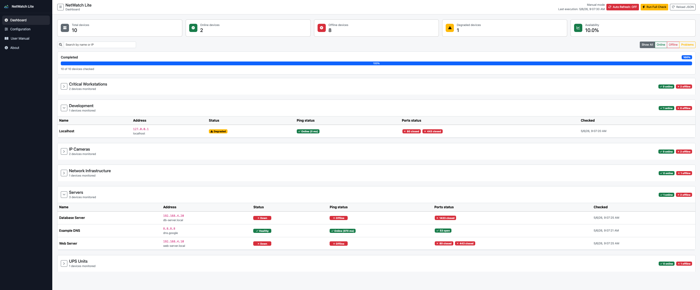
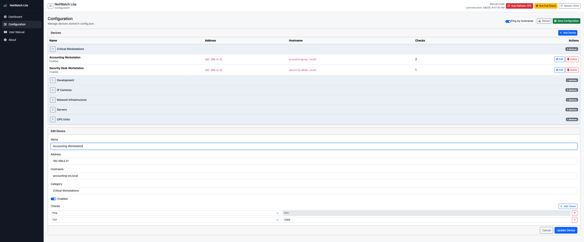

# NetWatch-Lite

NetWatch-Lite is a .NET 8 ASP.NET Core + Bootstrap network monitoring dashboard.
It stores local profiles in SQLite or compatible JSON, runs asynchronous ping,
TCP and HTTP/HTTPS checks, groups results by region/facility/category and can be
published as a portable Windows executable with the .NET runtime included.

Full visual documentation is available at [docs/index.html](docs/index.html).
When the service is running, open `/docs/` or use the `Documentation` link in
the application sidebar.

Engineering documentation starts at [docs/README.md](docs/README.md).

Automated validation includes .NET unit/integration/contract tests and
Playwright desktop/mobile workflows. See [testing](docs/TESTING.md) for commands
and isolated browser test data.

Continuity notes for future Codex sessions are available in [AGENTS.md](AGENTS.md) and [CURRENT_STATUS.md](CURRENT_STATUS.md).

Release notes and commit-level project history are summarized in [CHANGELOG.md](CHANGELOG.md).

GitHub repository: [https://github.com/dafermen/netwatch-lite](https://github.com/dafermen/netwatch-lite).

## Portable Download

[Download Windows x64 ZIP 0.8.0-rc.13](https://github.com/dafermen/netwatch-lite/releases/download/v0.8.0-rc.13/NetWatch-Lite-v0.8.0-rc.13-win-x64.zip)
and [SHA-256 checksum](https://github.com/dafermen/netwatch-lite/releases/download/v0.8.0-rc.13/NetWatch-Lite-v0.8.0-rc.13-win-x64.zip.sha256).
This is a validated prerelease, not stable-deployment approval. The public download
matches the immutable local package; all four CI jobs passed for its source commit.

The new Windows x64 candidate is `0.8.0-rc.13`, including dashboard
inventory search, copy-only device Commands, exact single-device checks, filter
reset/header controls, neutral Configuration layout and transition-safe device
deletion, plus the redesigned Reports Summary/Runs/Devices views, historical
filters, detail and CSV/JSON exports. It also includes optional device Notes for
physical location, assigned user or other inventory observations, with search
and safe read-only disclosures in Configuration/Dashboard. Candidate rc.6 adds
a separate Location field before Notes for floor/office/desk, distinct from
Facility grouping, with preservation and search. Candidate rc.7 adds a separate
Wireless/Cabled Link type on each printer/scanner assignment; legacy values remain
Not recorded and USB/Network/Other keeps its existing meaning. Candidate rc.8 adds
visible Configuration search matches, a check-driven device form with Web application
preset, clearer network/website/monitor URL fields, and transactional SQLite with
offline migration/backup/JSON reversal. Existing JSON is never silently imported;
clean installs select SQLite. Candidate rc.9 adds accessible helper text below
Shortcuts and Command without changing stored values or clipboard behavior.
Candidate rc.10 removes the Shortcuts note to save space, retains Command help,
and explains HTTP Timeout/Expected text beside their fields. Retry controls remain
in Configuration > Settings for the active support group.
Candidate rc.11 adds SQLite schema-2 history/inventory projections, bounded SQL
Reports with complete filtered totals/exports, configurable retention, private
change history and managed verified backups. Open Configuration > Data & backups.
Schema-1 upgrade creates a private verified backup first; older binaries require
restoring that snapshot into a separate folder. Existing document/API/JSON
contracts remain compatible; projections are never independently editable.
Candidate rc.12 searches each monitored URL, reveals saved device edits/copies
instead of leaving them filtered out or collapsed, and keeps HTTP-only forms
compact by hiding Location/Command without deleting their saved values. It also
shows field/API failures inside the editor and preserves safe save retries.
Reports now waits for execution deletion to finish before refreshing SQL pages.
Candidate rc.13 adds a Device Type selector immediately before Category. It uses
the active profile catalog, filters pending/checked inventory and intersects the
server-side scope of Facility/Category, individual and failed checks. Global
automatic monitoring remains global. See [dashboard filters](docs/DASHBOARD_FILTERS.md).
The owner authorized this repository update and prerelease portable publication
on 2026-11-11. Publication results are recorded in CURRENT_STATUS; a candidate is
not stable-deployment approval.
Candidate release page: [v0.8.0-rc.13](https://github.com/dafermen/netwatch-lite/releases/tag/v0.8.0-rc.13).
See [storage](docs/STORAGE.md),
[device form/search](docs/DEVICE_FORM.md) and [work-order validation](docs/VALIDATION_WORK_ORDER_2026-11-10.md).
Every portable delivery includes its
versioned folder, ZIP and SHA-256 sidecar under `artifacts/portable/` and
`artifacts/packages/`; use the ZIP to copy/share the complete application.
See [dashboard validation](docs/VALIDATION_DASHBOARD_TYPES_2026-11-11.md)
for current build evidence and limits; [URL CRUD validation](docs/VALIDATION_URL_CRUD_2026-11-11.md)
is the preceding checkpoint. Stable deployment still requires its separate gates;
private runtime data is excluded.
The immutable rc.3 and older candidates predate the Reports redesign and remain
unchanged. Generating another build always requires a new version.
Candidate rc.4 includes Reports but predates Notes; older binaries/clients can
discard this optional field when saving a newer inventory.
Candidate rc.5 includes Notes but predates Location and remains unchanged.
Candidate rc.6 includes Location but predates peripheral Link type; all previous
portable folders/ZIPs remain immutable.

Historical Windows x64 ZIP (predates the current candidate):

[Download NetWatch Lite portable ZIP v0.7.1](https://github.com/dafermen/netwatch-lite/raw/refs/heads/main/releases/NetWatch-Lite-win-x64-portable-2026-06-27-v0.7.1-reports-integrations-polish.zip)

Extract the ZIP on Windows and run `NetWatch-Lite.exe`. The ZIP includes a safe `config.sample.json`; NetWatch Lite creates the editable runtime `config.json` and `themes.json` beside the executable on first run if they do not already exist.

Previous published versions remain in [the GitHub releases directory](https://github.com/dafermen/netwatch-lite/tree/main/releases). New local
versioned candidates are generated under `artifacts/portable/` and
`artifacts/packages/`; generating one does not update GitHub automatically.
See [versioned portables](docs/PORTABLE.md) for the current safe workflow.

## Screenshots

### Dashboard



### Configuration



## Features

- Transactional SQLite schema 2 for clean installations; backed-up schema-1
  upgrade, relational history/inventory queries, private change auditing and global
  retention/managed backup controls. Explicit byte-preserving
  offline migration for existing JSON, private backups, integrity checks and
  current-data JSON export for reversal. Provider status is at `/api/storage`.
  JSON import/export remains compatible. SQLite is not a separate server and
  does not imply authentication or network-share/multi-instance support.
- Configuration search reveals matching groups without executing or saving.
  The device form follows both classification and configured checks; new Web
  application records start with HTTP only, not an unintended Ping.
- Profile-scoped Device Types master at `/device-types`, with custom type
  create/rename/delete, usage counts, filters and dynamic editor options.
  The five legacy types, including Workstation, are protected; in-use types
  cannot be deleted. Catalog-only edits detect stale profile/catalog changes.
  See [Device Types](docs/DEVICE_TYPES.md).
- Local inventories with JSON import/export and independent Support Group profiles for multiple operational teams inside a region.
- Full-width Support Groups manager at `/regions`, grouped by region with
  search/filters, independent active/selected states, row actions and direct
  access to the chosen configuration. Profile data/IDs and protections remain.
- Printer/scanner catalog at `/peripherals`, with manufacturer/model records
  scoped to the active support group and optional assignments to workstations.
  Printers/scanners independently distinguish unrecorded, none and assigned;
  multiple USB/network/other peripherals can be recorded with IDs and notes.
  Each physical assignment also records Wireless/Cabled independently, with
  Not recorded for unknown links. The editor and inventory details preserve/show
  it without changing address rules, inventory-pending counts or monitoring.
  This is manual inventory, not automatic peripheral health detection. See
  [the inventory guide](docs/PERIPHERALS.md).
- Read-only Workstations inventory at `/workstations`, with combined facility,
  model, search and pending-inventory filters, plus paginated desktop/mobile
  records. Select a model name in Peripherals to find its workstations; repeated
  units do not duplicate the workstation row. None and Not recorded remain distinct.
- Device categories such as `Servers`, `Critical Workstations`, `IP Cameras`, and `Power Devices`.
- Async ping checks with latency in milliseconds.
- Optional per-device hostname-based ping mode for networks where IP addresses can change.
- Optional `websiteUrl` per device for opening an associated web page from the dashboard.
- Optional per-device `command`, edited beside Website URL. Dashboard Command
  copies its literal text to the clipboard; it never launches an executable.
  Commands survive current edits/copies/bulk saves/import/export/profile copies.
- Optional single-line `location` before Notes, for a floor, office or desk
  within a Facility (max 200 characters). Displayed/searched in Configuration
  and Dashboard without changing Facility/category execution scope. Current
  editing/copy/bulk/profile/import/export workflows preserve it; history does
  not include it. Existing Notes is never automatically extracted or rewritten.
- Optional multiline `notes` for assigned user and other
  inventory observations (max 2000 characters). Edit Notes in the normal or
  Advanced device form, search it in Configuration/Dashboard and open its
  compact disclosure. Preserved through copy/bulk/profile/export workflows;
  not copied into monitoring history. See [operations](docs/OPERATIONS.md#device-notes).
- Async TCP port checks.
- HTTP/HTTPS URL checks with per-attempt timeout, exact expected status,
  optional literal expected text, duration and failure messages in Dashboard
  and Reports. Anonymous GET only, strict TLS and no automatic redirects.
  See [HTTP checks](docs/HTTP_CHECKS.md) for setup, limits and compatibility.
- Parallel execution with `Task.WhenAll`.
- Global concurrency limit with `maxParallelChecks`.
- Configurable retry count and retry delay for ping, TCP and HTTP failures.
- Aggregated status:
  - `Healthy`: every configured ping, TCP and HTTP check succeeds.
  - `Degraded`: at least one check succeeds, but one or more checks fail.
  - `Down`: no configured checks succeed.
- Dashboard summary metrics:
  - Total devices.
  - Online devices.
  - Offline devices.
  - Degraded devices.
  - Availability percentage.
- Search and client-side filters.
- Dashboard search includes enabled configured devices before any execution.
  Unmeasured devices show Not checked and are excluded from Offline/Problems;
  partial runs retain searchable pending rows and all configured facility tabs.
- Dashboard results group by facility and then category in the all-facilities view; facility/category groups collapse after a full check and show green, orange, or red health bars.
- Hamburger sidebar navigation.
- Branded NetWatch Lite logo and favicon.
- Embedded Windows executable icon for portable builds.
- Built-in User Manual and About pages.
- Built-in Themes page for reusable GUI color templates stored in `themes.json`.
- Searchable Themes library with palette swatches, row actions and a separate
  color draft/preview. New/copy/rename save immediately; Save Colors persists
  color edits, and activation applies only after confirmation by the backend.
  Shared confirmations, modal focus and responsive master layouts cover Device
  Types and Peripherals too. See [administration](docs/ADMINISTRATION.md).
- Companion Windows WebView2 wallboard is maintained in the sibling `netwatch-lite-wallboard` repository.
- Responsive layout for desktop, tablet, and mobile screens.
- Configuration page at `/config`.
- CRUD UI for devices and checks stored in the active support group JSON.
- Editable auto refresh interval, timeout, max parallel check limit, and per-device ping target mode in `/config`.
- Add, update, and delete device actions save immediately to the active support group JSON.
- Copy device action opens a prefilled add form so similar devices can be created quickly.
- Bulk Edit mode lets operators filter by facility/category and update common device fields in a grouped spreadsheet-style table, with individual row saves, collapse/expand-all facility controls, and validation.
- Theme templates can be created, copied, renamed, activated, deleted one at a time, or fully reset from the Themes page. If `themes.json` is missing, NetWatch Lite creates the default theme automatically.
- Configuration device table grouped by facility and category for easier editing.
- Configuration devices can be filtered by name, address, hostname, facility, or category.
- Configuration facility and category groups are nested and collapsed by default.
- Default Configuration headers use neutral grays in normal and Bulk Edit views;
  custom theme colors remain supported. Edit/Copy/Delete use aligned icon buttons
  with hover titles and accessible names, without wrapping into separate rows.
- Configuration Bulk Edit supports selecting visible rows and applying common changes to many devices in one save.
- Add/edit device form opens in a modal so large category lists do not push the editor out of view.
- Configuration JSON export and import from `/config`, with server-side validation before imported files replace the active support group config.
- Manual mode by default.
- Optional auto refresh toggle that runs a full check using `settings.intervalSeconds`.
- Execution mode toggle for `Full Check` or `Ping Only` connectivity checks without changing the saved JSON.
- Forced full check.
- Category-scoped dashboard checks for running one group, such as IP Cameras, without checking the full inventory.
- Device-scoped dashboard checks for rerunning one row without checking the full inventory.
- Failed-device retry button that appears only when current dashboard results include `Degraded` or `Down` devices.
- Progressive dashboard rendering through Server-Sent Events while checks are still running.
- Visible monitoring progress with percentage and checked/total count while a run is active.
- JSON reload without restarting.
- Local monitor history persisted in SQLite, with compatible `monitor-history.json`
  document shape and optional JSON-provider storage for reporting and recovery.
- Reports at `/reports` with Summary/Runs/Devices tabs, shared historical
  support-group/Facility/category/date filters, distinct device/evaluation
  metrics, recorded check details, responsive ordering and CSV/JSON export.
  Healthy evaluations is a sample ratio, not continuous uptime. Per-run deletion
  is confirmed and ambiguous legacy IDs remain read-only. See [reports](docs/REPORTS.md).
- Local application error log stored in `app-errors.json` for troubleshooting where the app fails.
- Integrations page at `/integrations` for choosing local JSON or a future external inventory endpoint, plus future outbound report endpoint settings.
- Future-ready reporting model: operator identity, audit fields, and external integrations are planned but not enabled yet.

## Project Structure

```text
netwatch-lite/
|-- .github/              GitHub workflows and contribution templates
|-- Assets/               Application icon
|-- Data/                 Safe sample configuration
|-- Models/               API and persistence models
|-- Services/             Repositories and monitoring services
|-- docs/                 Canonical engineering documentation
|-- tests/
|   |-- NetWatch.ContractTests/
|   |-- NetWatch.UnitTests/
|   `-- NetWatch.IntegrationTests/
|-- wwwroot/              Static Bootstrap frontend
|-- AGENTS.md             Mandatory Codex instructions
|-- CURRENT_STATUS.md     Current phase and pending work
|-- CONTRIBUTING.md       Contribution workflow
|-- NetWatch.csproj       Main ASP.NET Core project
|-- netwatch.sln          Application and test projects
`-- Program.cs            Minimal API entry point
```

## Configuration

The device JSON path is configured in `appsettings.json`.

```json
{
  "NetworkMonitor": {
    "DeviceFilePath": "config.json",
    "ProfileFilePath": "regions.json",
    "ThemeFilePath": "themes.json",
    "HistoryFilePath": "monitor-history.json",
    "ErrorLogFilePath": "app-errors.json",
    "IntegrationFilePath": "integrations.json"
  }
}
```

During local development, `Data/config.json`, `Data/regions.json`, and `Data/regions/*.json` are treated as private local files and are ignored by Git. `Data/config.sample.json` is the safe starter example that can be committed. If runtime profile metadata is missing on first run, NetWatch Lite creates a `Support Team A` profile in `Sample Region` from the existing `config.json` when available, plus a protected `Demo` profile from `config.sample.json`. Dashboard and Configuration always operate on the active support group profile.

`themes.json` stores GUI theme templates and the active theme id. It is runtime data and is ignored by Git, just like `config.json`. If it is missing, NetWatch Lite creates the built-in `NetWatch Default` and `Corporate Logistics` themes automatically. Theme color tokens include page/surface/sidebar colors, status colors, dashboard category health colors, Configuration collapsible header colors, and dashboard action colors for `Auto Refresh: ON`, `Auto Refresh: OFF`, and the primary run button.

`monitor-history.json`, `app-errors.json` and `integrations.json` are logical
documents in the selected store: SQLite by default, physical JSON only in JSON
mode. They retain execution timing/scope/results, errors and integration settings.
Schema 2 adds relational report/inventory projections and private audit changes.
`storage-policy.json` holds global retention/backup settings. Databases, runtime
documents, archives, backups and exports are private, ignored by Git and excluded
from portables. See [storage](docs/STORAGE.md) for schema upgrade and recovery.

Future history versions should add audit context without breaking existing local files. Planned fields include `executedBy`, `executedByDisplayName`, `authProvider`, `triggerSource`, `correlationId`, and optional external reference ids. These fields are intentionally not active yet because NetWatch Lite does not currently authenticate users.

## Device JSON Format

```json
{
  "settings": {
    "intervalSeconds": 15,
    "timeoutMs": 1000,
    "maxParallelChecks": 50,
    "retryCount": 0,
    "retryDelayMs": 250
  },
  "devices": [
    {
      "name": "Web Server",
      "ip": "192.0.2.10",
      "hostname": "web-server.local",
      "useHostnameForPing": true,
      "websiteUrl": "https://example.local/status",
      "region": "Sample Region",
      "supportGroup": "Support Team A",
      "facility": "Miami Warehouse",
      "category": "Servers",
      "enabled": true,
      "checks": [
        { "type": "ping" },
        { "type": "tcp", "port": 80 },
        { "type": "tcp", "port": 443 }
      ]
    }
  ]
}
```

Use `facility` for the physical site, warehouse, branch, or datacenter where the device lives. The dashboard shows facilities as quick tabs so operators can focus or run one site at a time; missing values are normalized to `Unassigned`. Use `category` to group device types inside each facility. Use `enabled: false` to keep a device in the file without monitoring it. Use optional `websiteUrl` to show an `Open website` link in the dashboard; it must be an absolute `http://` or `https://` URL. Set `useHostnameForPing` on each device to choose whether that device's ping checks use `hostname` or `ip`. TCP checks continue to use `ip`.

## Companion Wallboard Project

The Windows WebView2 wallboard is maintained as a separate sibling project:

[https://github.com/dafermen/netwatch-lite-wallboard](https://github.com/dafermen/netwatch-lite-wallboard)

That project renders operational monitoring pages in native WebView2 panels for pages that block iframe embedding.

## API Endpoints

| Method | Endpoint | Purpose |
|---|---|---|
| `GET` | `/api/devices` | Returns normalized devices from the loaded JSON. |
| `POST` | `/api/reload` | Reloads the active support group JSON from disk. |
| `GET` | `/api/config` | Returns the full editable configuration. |
| `POST` | `/api/config` | Saves the full active support group configuration, creates a sibling backup, and reloads memory. |
| `POST` | `/api/config/devices/{deviceIndex}` | Validates and saves one device row from Bulk Edit, then reloads the active support group configuration in memory. |
| `GET` | `/api/config/export` | Downloads the current normalized configuration as JSON. |
| `POST` | `/api/config/import` | Imports a `.json` config file, validates it, creates `config.backup.json`, saves it, and reloads memory. |
| `GET` | `/api/themes` | Returns normalized theme templates from `themes.json`, creating the default theme when missing. |
| `POST` | `/api/themes` | Saves theme templates after validation and normalization. |
| `POST` | `/api/themes/reset` | Resets theme templates to the built-in default. |
| `GET` | `/api/results` | Backwards-compatible endpoint that forces a full check. |
| `POST` | `/api/monitor/run` | Forces a full check and prevents overlapping executions. Supports `checkMode=ping` for connectivity-only runs. |
| `GET` | `/api/monitor/stream` | Streams a full check progressively with `started`, `result`, `completed`, `busy`, and `error` events. Supports optional `facility`, `category`, `deviceName`, `deviceIp`, and `checkMode=ping` query filtering. |
| `GET` | `/api/history` | Returns compatible local monitoring history from the active store. |
| `GET` | `/api/reports/query` | Returns bounded SQL report pages and whole-filter metrics. |
| `GET` | `/api/inventory/query` | Returns active-profile relational inventory pages. |
| `GET` | `/api/storage/audit` | Returns private paginated field changes. |
| `GET/PUT` | `/api/storage/policy` | Reads/saves global retention and backup policy. |
| `GET/POST` | `/api/storage/backups` | Lists managed snapshots or creates a verified backup. |
| `POST` | `/api/history/clear` | Clears local monitoring history for maintenance or demo reset. |
| `DELETE` | `/api/history/runs/{runId}` | Deletes one stored monitoring execution without clearing the full history file. |
| `GET` | `/api/errors` | Returns local application errors from `app-errors.json`. |
| `POST` | `/api/errors/clear` | Clears local application errors for maintenance or demo reset. |
| `GET` | `/api/integrations` | Returns local integration settings from `integrations.json`. |
| `POST` | `/api/integrations` | Saves integration settings locally without calling external systems. |

## Security Model

NetWatch Lite is designed as an internal operational tool. Its current security posture is based on keeping sensitive inventory data local, validating all configuration changes on the server, and avoiding unnecessary infrastructure exposure.

Built-in safeguards:

- Runtime inventory files are ignored by Git: `Data/config.json`, `Data/regions.json`, `Data/regions/*.json`, and `Data/themes.json`.
- Runtime history, troubleshooting, and integration settings files are ignored by Git: `Data/monitor-history.json`, `Data/app-errors.json`, and `Data/integrations.json`.
- The committed sample file is generic and safe: `Data/config.sample.json`.
- Portable releases are built with only the safe `config.sample.json`, not active operational profiles.
- JSON import rejects empty files, non-`.json` files, files larger than 5 MB, malformed JSON, and invalid monitor configurations.
- Configuration saves are validated server-side before writing to disk.
- JSON saves write and flush a temporary file before replacing the destination;
  sibling `*.backup.json` files preserve the previous successful version.
  Backups and temporary files remain private and are excluded from publication.
- Configuration saves/imports reject null device/check entries with HTTP 400;
  unexpected errors return a controlled problem response with a trace identifier.
- Monitoring endpoints prevent overlapping executions.
- Network check failures are handled as device status results instead of crashing the app.

Current scope and deployment expectation:

- The app does not currently include built-in user authentication or role-based access.
- Deploy it only on a trusted internal workstation/server or behind existing controls such as VPN, firewall rules, reverse proxy authentication, or Windows access controls.
- Treat device inventories, hostnames, IP addresses, facilities, and support group profiles as internal operational data.

Future identity direction:

- Add Microsoft Entra ID authentication before NetWatch Lite becomes a shared multi-user service.
- Record who executed each check once authenticated identity is available.
- Keep audit fields optional during the local-file phase so existing `monitor-history.json` files remain readable.
- Separate human-triggered runs from automatic, scheduled, API-triggered, or integration-triggered runs with a `triggerSource` value.

Future integration direction:

- Inbound integrations may later create check requests, import inventory metadata, or receive external incident context.
- Outbound integrations may later send availability events, report exports, Teams/email notifications, ticket updates, or webhook payloads.
- Current `/integrations` settings are configuration only; they do not import inventory or send reports yet.
- Each integration should use explicit authentication, request logging, correlation ids, and allowlisted destinations before production use.

## Integrations Design

The `/integrations` page is the planning surface for future data exchange. The current implementation only saves local settings in `integrations.json`; it does not call external systems yet.

### Receive Inventory Data

Goal: allow NetWatch Lite to load facilities, devices, categories and checks from
an approved external system. Until that connector exists, the local profile in
SQLite/compatible JSON remains authoritative. The legacy Integrations label/key
`Local JSON` does not select the storage engine.

Expected external inventory payload:

```json
{
  "schemaVersion": 1,
  "sourceSystem": "inventory-platform",
  "generatedAt": "2026-06-27T16:00:00Z",
  "region": "Sample Region",
  "supportGroup": "Support Team A",
  "facilities": [
    {
      "name": "Facility A",
      "devices": [
        {
          "name": "Device-001",
          "ip": "192.0.2.20",
          "hostname": "device-001.example.local",
          "facility": "Facility A",
          "category": "Servers",
          "enabled": true,
          "useHostnameForPing": false,
          "websiteUrl": "https://device-001.example.local",
          "checks": [
            { "type": "ping" },
            { "type": "tcp", "port": 443 }
          ]
        }
      ]
    }
  ]
}
```

### Send Report Data

Goal: allow NetWatch Lite to send report output from local monitor history to an approved external endpoint. The intended source is the same filtered report model shown in `/reports`: execution metadata, summary values, and optional detailed device rows.

Expected outbound report payload:

```json
{
  "schemaVersion": 1,
  "sourceSystem": "netwatch-lite",
  "exportedAt": "2026-06-27T16:05:00Z",
  "runId": "20260627-160500-123-full",
  "scope": {
    "region": "Sample Region",
    "supportGroup": "Support Team A",
    "facility": null,
    "category": null
  },
  "summary": {
    "totalDevices": 25,
    "healthyDevices": 22,
    "degradedDevices": 2,
    "offlineDevices": 1,
    "availabilityPercentage": 88.0
  },
  "rows": [
    {
      "deviceName": "Device-001",
      "ip": "192.0.2.20",
      "hostname": "device-001.example.local",
      "facility": "Facility A",
      "category": "Servers",
      "status": "Healthy",
      "latencyMs": 4,
      "checkMode": "Full",
      "completedAt": "2026-06-27T16:05:00Z"
    }
  ]
}
```

### Future Security Requirements

- Authentication should use Microsoft Entra ID when NetWatch Lite becomes a shared internal service.
- Endpoint credentials or tokens must not be stored in Git or committed runtime files.
- External destinations should be allowlisted before outbound report delivery is enabled.
- Every inbound or outbound request should include a correlation id and be logged.
- Failed outbound delivery should retry with a bounded policy and then record failure details in local logs.
- Imported inventory must be validated with the same server-side rules used by local JSON import.
- Report delivery should clearly separate human-triggered, auto-refresh, scheduled, API, and integration-triggered runs.

## Version Notes

Changes are documented in [CHANGELOG.md](CHANGELOG.md). Each Git commit should keep a concise message describing the change, and user-facing changes should also be added to the changelog.

## License

NetWatch Lite is released under the [MIT License](LICENSE). You can use, copy, modify, merge, publish, distribute, sublicense, and sell copies of the software under the license terms.

## Source Documentation

The C# source includes XML documentation comments for models and services. The frontend JavaScript includes JSDoc comments for dashboard rendering, filtering, backend calls, and execution controls.

Operational readiness documents:

- [Documentation Index](docs/README.md)
- [Architecture](docs/ARCHITECTURE.md)
- [API](docs/API.md)
- [Development](docs/DEVELOPMENT.md)
- [Testing](docs/TESTING.md)
- [Deployment](docs/DEPLOYMENT.md)
- [Operations](docs/OPERATIONS.md)
- [Security](docs/SECURITY.md)
- [Troubleshooting](docs/TROUBLESHOOTING.md)

The project also enables XML documentation generation in `NetWatch.csproj`:

```xml
<GenerateDocumentationFile>true</GenerateDocumentationFile>
```

## Build and Run

Install the .NET 8 SDK, then run:

```bash
dotnet restore netwatch.sln
dotnet build netwatch.sln
dotnet test netwatch.sln
dotnet run --urls http://localhost:5000
```

Open the URL printed by `dotnet run`, usually `http://localhost:5000`, `https://localhost:5001`, or another available local port.

## Create Windows Portable Build

Generate and verify a self-contained Windows x64 candidate:

```powershell
.\scripts\test-packaging.ps1
.\scripts\publish-portable.ps1 -Version 0.8.0-rc.1
```

Expected output:

```text
artifacts/
|-- portable/NetWatch-Lite-v0.8.0-rc.1-win-x64/
|-- packages/NetWatch-Lite-v0.8.0-rc.1-win-x64.zip
|-- packages/NetWatch-Lite-v0.8.0-rc.1-win-x64.zip.sha256
`-- verification/{run-id}/
```

Versions are never overwritten. The ZIP is extracted and tested on an ephemeral
loopback port before promotion. Only explicit public assets, runtime binaries,
licenses and generated neutral settings/sample data are included, not private
inventories or developer configuration. The full application directory is
portable; this is not a single-file executable.

Extract the ZIP into a new deployment folder and run `Start-NetWatch.cmd` to use
port 5000. Keep the historical portable folder unchanged. Runtime profiles and
themes are created in the new extraction; configure them privately through the
UI. See [PORTABLE.md](docs/PORTABLE.md) for retesting, failure recovery and rollback.
Package success does not replace the thirteen deployment quality gates.

## Operational Notes

- `Run All Facilities` executes all configured checks immediately.
- Facility tabs focus the dashboard on one site. The same primary run button changes to `Run Facility` and executes checks only for the selected facility.
- `Run Group` checks the selected category within the selected facility, or
  across all facilities in the active support group when All Facilities is
  selected. The search textbox filters the view, not execution scope.
- `Full Check` runs configured ping, TCP and HTTP/HTTPS checks; `Ping Only` runs connectivity checks only and shows TCP/HTTP checks as skipped for that execution.
- `Run Failed` appears only when the current dashboard has `Degraded` or `Down` devices and retries only those devices.
- Row `Run` is available for every displayed device, including healthy ones;
  it checks that exact name/address/facility/category and merges only its result.
- Clear all dashboard filters resets Facility, group, textbox and status without
  running checks or deleting results/history. Untested facility tabs remain.
- Facility/category header bands toggle their sections, except interactive
  controls such as Run; arrow buttons retain normal keyboard support.
- The dashboard starts in manual mode with searchable inventory and neutral
  Not checked states. Typing never starts checks or adds history. Search opens
  matching sections, and clearing it restores their prior expansion state.
- Summary counts cover the selected facility (or all facilities), independently
  of text/status filters. Availability uses checked devices only and stays
  unavailable until a result exists; pending devices are not counted as offline.
- Full checks stream results progressively, so devices appear as they finish instead of waiting for the whole execution.
- When a full check finishes, facilities show compact collapsible rows with nested category groups. Category groups collapse and show green when every device is healthy, orange when devices are degraded but none are down, and red when at least one device is down.
- The monitoring progress bar is visible only while a full check is running.
- NetWatch Lite starts in manual mode by default.
- `Auto Refresh` runs a full check immediately after the operator turns it on, then repeats every `settings.intervalSeconds`.
- `settings.intervalSeconds` is editable from Configuration and controls the auto full-check timer.
- Auto refresh keeps existing dashboard groups visible while the next full check updates devices progressively.
- Invalid or corrupt `config.json` content is reported through the API/UI instead of crashing silently.
- Missing `config.json` is recreated automatically with a starter `Localhost` ping device.
- If an operating system ping succeeds but NetWatch Lite shows a ping failure, compare the device ping target mode, configured `timeoutMs`, `retryCount`, and `retryDelayMs`. NetWatch Lite uses the per-device `useHostnameForPing` value and the configured timeout, which may be shorter than the operating system ping command's default wait time.
- Configuration read/write problems return controlled API errors so the Configuration page can show the message to the operator.
- Bulk Edit actions can update selected devices by facility, category, enabled state, or ping target mode in one save; the previous JSON file is backed up before replacement.
- JSON import rejects empty files, non-`.json` files, files larger than 5 MB, malformed JSON, and invalid monitor configurations before replacing the current file.
- Runtime support group profiles and themes are local operational data; do not commit them to Git or include them in public releases.
- Monitoring stream failures are logged by the backend and sent to the dashboard as an `error` event when the client is still connected.
- If a group check fails while previous dashboard results are visible, the UI keeps those results on screen and reports the failure in the status line.
- `maxParallelChecks` should be adjusted carefully for large networks.
- `retryCount` adds extra attempts after a failed ping, TCP or HTTP check. Higher values can improve transient failures but increase total runtime.
- `retryDelayMs` controls the pause between retry attempts.
- TCP checks treat timeouts, refused connections, invalid targets, and unexpected socket failures as unavailable ports; they do not validate application protocol behavior.
- On small screens, wide device tables scroll horizontally while toolbars and forms stack vertically.

## DOC-STD-20261002 — Documentation navigation

Use the [documentation map](docs/README.md) for authoritative sources, reading paths and project-specific maintenance rules.

The documentation uses the configurable InnovaLogic reading theme, reading paths and keyboard controls; see [navigation maintenance](docs/WEB_NAVIGATION.md).
